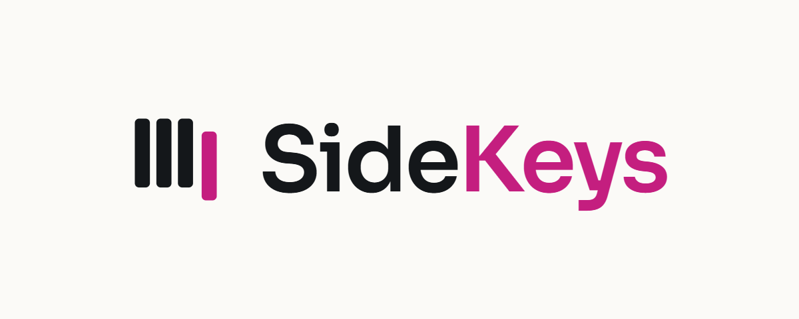
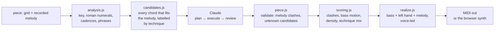

<h1 align="center">
  <picture>
    <source media="(prefers-color-scheme: dark)" srcset="assets/logo-lockup.png">
    
  </picture>
</h1>

[](https://github.com/EdiTnss/SideKeys/actions/workflows/test.yml)

**The teacher who sits next to you and tells you what your hands got wrong.**

SideKeys listens to what you play on a MIDI keyboard and answers in under 100 ms: which
voicing you used, which chord tones are missing, which notes are wrong, where the left hand is
too low to sound clear, and how smoothly you moved from the chord before.

Everything in that answer is computed, not guessed. No model is asked what a Dm7 is.

<!-- demo.gif -->

## What you actually do with it

A path of eight units, from triads to ii–V–I in twelve keys, all of them open from the start. A level
asks for a chord, you play it, and the keyboard answers immediately — green for the chord tones
you found, a dotted outline for the ones you did not. A pass earns up to three stars:

| star | name | what it asks |
|---|---|---|
| ★ | **Right** | you played the chord that was asked for |
| ★★ | **Clean** | nothing to reproach: no avoid notes, nothing muddy |
| ★★★ | **Smooth** | the same, against the metronome, with the voices moving as little as the progression allows |

The thresholds are measured rather than felt — a well-led ii–V–I moves 0.75 semitones per voice
and a careless one moves 4.00, so the star sits at 1.25. The method and the table are in
[docs/spec-game.md](docs/spec-game.md).

A level may also demand a *shape* — play this as a shell, a rootless A or B, a drop 2, a
quartal — and a slash chord checks the bass you put underneath it. Every level is tested to be
answerable: a test walks each chord it asks for through the voicing generator and fails if no
clean voicing of the demanded shape exists.

**A daily challenge**, the same ten chords for everyone, drawn from the date itself — xmur3 into
mulberry32, so there is no server and no account, and two browsers on the same day draw the same
ramp. It climbs from a triad to a quartal, so a beginner earns the first squares rather than a
blank grid, and the result pastes as a row of squares:

```
SideKeys #1 · 8/10 clean
🟩🟩🟩🟩⬛🟩🟩🟩🟩⬜
```

**Training**, for when you want none of that: pick the chords, the keys and a shape, or loop a
progression from the library with its bars as written, and play for as long as you like. No
stars and nothing to open, but the minutes count, and in a progression every change tells you
how far the voices moved.

Whatever you miss comes back tomorrow in *Review* and leaves after three clean answers in
a row. The app installs as a PWA and works with the network off, because everything it does is
arithmetic in your browser.

**No MIDI keyboard?** The drawn one is a real MIDI input, not a special case: click the keys to
arm them and press <kbd>Enter</kbd>, or hold <kbd>A</kbd> <kbd>S</kbd> <kbd>D</kbd> <kbd>F</kbd>
like a piano. A Web Audio synth appears as a MIDI *output* beside your real ports. Chrome or
Edge; Web MIDI does not exist in Safari.

**[Play it →](https://editnss.github.io/SideKeys/)** — no account, no install, nothing to sign up
to. The analyzer bench this grew out of, with the drill, the progressions and the
reharmonizer, is at **[/lab/](https://editnss.github.io/SideKeys/lab/)**.

## How the analyzer works

A chord symbol is parsed into chord tones, available tensions and avoid notes; the notes you
played are matched against it, and the result is a list of messages in a fixed order — what is
wrong first, what is missing next, then what you actually built.

| You are asked for | You play | It answers |
|---|---|---|
| `Dm7` | F2 A2 C3 E3 | Rootless voicing (no D) · **Muddy: F2–A2 (M3) is too low** · **Muddy: A2–C3 (m3) is too low** · Rootless A |
| `Cmaj7` | C4 F4 G4 B4 | **Missing E (3)** · **Avoid note: F (11)** · Close position |
| `Dm7` | E3 A3 D4 F4 | **Missing C (b7)** · Drop 2 |

The low interval limits in the first row are the point: the voicing is correct on paper and
muddy under the hands. The rules are written down in [docs/spec-analyzer.md](docs/spec-analyzer.md)
and each one has a test.

This is also the bench the project grew out of, and it is still here: a drill over the qualities
and keys you pick, progressions from a small library or from a grid you type
(`| Dm7 G7 | Cmaj7 | % |`), free or against a metronome, with a voice-leading score for the pass
and statistics for your weak spots.

## The hybrid reharmonizer

A second, separate thing this repo demonstrates: a language model placed where it is actually
good, and kept out of everywhere else. You record a melody over your grid, and Claude
reharmonizes the tune without touching a note of the melody.



**Why not just ask the LLM?** Because a model asked for "a tritone sub in bar 5" will happily
return a chord that clashes with the melody note held over it, and you cannot tell which of its
answers did. Here the code generates every chord that fits the melody, labelled by technique;
the model only picks from that menu and says why; then the code validates the picks and scores
the result. What the model is good at — taste, shape across a phrase, an explanation in words —
is what it is asked for.

It is measured, not asserted. `eval/compare.js` runs the same tune through `execute` alone and
through `plan + execute + review`, several times, and writes the numbers to
[`eval/reports/`](eval/reports/). On a 64-bar study, three runs of each, the full pipeline
averaged 0.90 bass smoothness against 0.84 and 4.67 distinct techniques against 3.67 — with zero
melody clashes and the change density inside its target in every run of both.

The reharmonizer with an API call is **out of the product's scope** (see
[docs/PRODUCT.md](docs/PRODUCT.md)): it stays here as the technical demonstration, and the
published site makes no API calls at all. Run it yourself with your own key and it comes back on.
The arrangement half of it — grid and melody turned into bass, left hand and melody, voice-led
and playable on a real instrument — has no model in it and is part of the product.

## The verification harness

The app records the last hour of playing in memory — every note, every verdict — and "Save
session" writes it out as JSON. [`harness/replay.js`](harness/replay.js) replays those sessions
through the same capture and analysis code on a virtual clock and reports every snapshot whose
chord or verdict is no longer what it was.

CI replays three of them on every push, including eleven minutes of real playing on a Genos
(1160 events, 93 snapshots). It has already earned its keep: it found a chord pushed over the
bar line that silently received no verdict at all, and proved the fix left all 93 snapshots of
that session untouched. The game uses the same decision — `snapshotTarget` — to work out which
chord a voicing answers, so the game and the replay cannot come to disagree.

## Run it

The game, with hot reload:

```bash
npm --prefix app run dev
```

The analyzer bench (the original page, no build step):

```bash
npx serve .
```

Open the address each prints, in Chrome or Edge. On Windows, `start.cmd` opens the bench and the
local AI proxy in one double-click. `midi-test.html` is a diagnostic page for MIDI in and out.

**With a keyboard:** connect it before loading the page (or press "Connect a MIDI keyboard"), and
turn off any auto-accompaniment so only your own notes arrive.

**To turn on the Claude features** (explanations in the drill, reharmonization), run the proxy
from [`worker/`](worker/) with your own Anthropic API key and paste its URL into Settings. The
key never touches the frontend or this repository — see [worker/README.md](worker/README.md).

## Tests

```bash
npm test            # full report
npm run test:quiet  # one line when green
```

311 tests on Node 22+. The engine — everything the answers are computed from — is plain
JavaScript with **no dependencies and no build step**, which is why the same files run in the
browser, in the Worker, and under `node --test`. The shell on top of it is Vite, TypeScript and
Svelte 5, and it imports the engine untouched; nothing in the engine may import from the shell.

## Layout

| | |
|---|---|
| `src/theory/` | chords, analyzer, voice leading, stars, pieces, harmonic analysis, candidates, scoring, realization — pure, tested |
| `src/game/` | the path and its units, progress and the streak, the daily challenge — pure, tested |
| `src/midi/` | Web MIDI in and out, voicing capture, the virtual port |
| `src/audio/` | metronome, synth, sampled piano, the shared clock |
| `src/ui/` | the bench: rendering, the drill, the session tape, the on-screen keyboard |
| `src/ai/` | the prompts (versioned, in the repo) and the pipeline |
| `app/` | the game: Vite + TypeScript + Svelte 5, the service worker and the manifest |
| `worker/` | Cloudflare Worker: adds the key, checks the origin, limits per IP. No music logic, no prompts |
| `harness/` | recorded sessions and the replay |
| `docs/` | product scope, module specs, the session journal (in Romanian) |

## Credits

The piano is the **Salamander Grand Piano V3** by **Alexander Holm** — a Yamaha C5, recorded
with a pair of AKG C414s — used under
[CC BY 3.0](https://creativecommons.org/licenses/by/3.0/), with one velocity layer of sixteen
kept and seventeen notes of the full set. What was changed and why is in
[`app/public/piano/CREDITS.md`](app/public/piano/CREDITS.md).

## License

None. All rights reserved — the code is here to be read, not reused. That covers the code; the
piano samples above are the author's, under their own licence.
